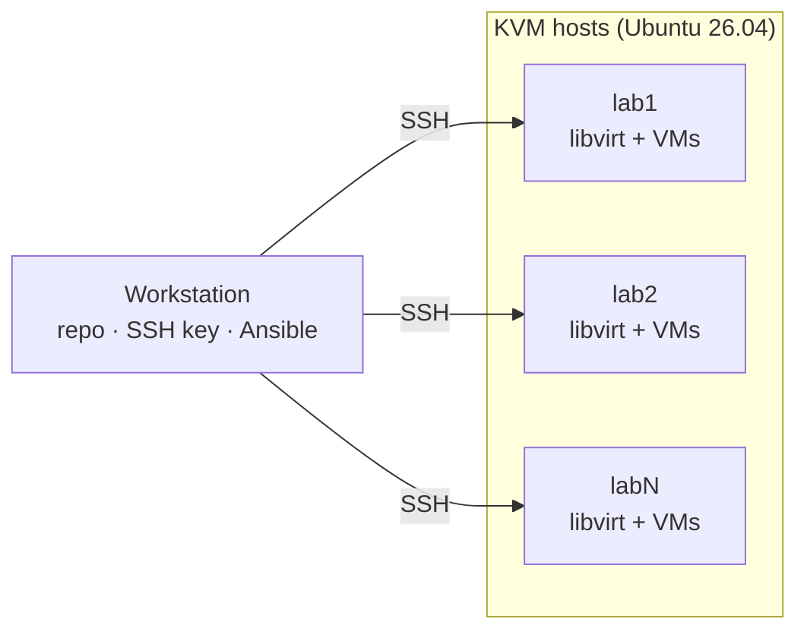

# Ephemeral Labs
Ephemeral Labs with KVM and Terraform/OpenTofu



## Setup

Run everything from your workstation; the targets are Ubuntu 26.04 hosts.

### 1. Prepare each target

* Turn on virtualization (VT-x/AMD-V) in BIOS/UEFI
* Install openssh-server
```bash
sudo apt update && sudo apt install -y openssh-server
```

### 2. Get the repo (workstation)

```bash
git clone https://github.com/turnes/ephemeral-labs.git
cd ephemeral-labs
```

### 3. Inventory

```bash
cp inventory.example.yml inventory.yml   # edit hosts
```

`inventory.yml` is an Ansible inventory; the SSH script reads it too.

### 4. SSH access

```bash
./bootstrap/setup-ssh.sh
```

This creates `~/.ssh/ephemeral-labs/id_ed25519`, writes one `~/.ssh/ephemeral-labs/<name>.conf` per host, adds `Include ~/.ssh/ephemeral-labs/*.conf` to `~/.ssh/config` and copies the key to each host. Re-run it after editing `inventory.yml`.

### 5. Install KVM

```bash
sudo apt update && sudo apt install -y ansible-core
ansible-playbook ansible/install-kvm.yml -K --tags hwcheck   # hardware check only
ansible-playbook ansible/install-kvm.yml -K                  # add -e kvm_with_gui=true for virt-manager
```

### 6. Verify

```bash
ssh lab1 kvm-ok
ssh lab1 virsh -c qemu:///system list --all
```

## Roadmap: `elab` CLI

A single entry point (`bin/elab`, bash) that wraps the scripts above:

```
elab check                  # hardware preflight
elab install                # install KVM on lab hosts (Ansible)
elab hosts add|rm|ls        # manage lab hosts
elab ssh setup | <name>     # set up keys / connect
elab up|down|status <lab>   # terraform in modules/
```

`elab hosts` edits `inventory.yml`, the single source for SSH and Ansible.
