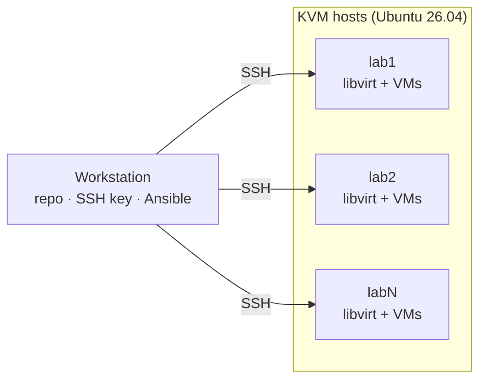

# Ephemeral Labs
Ephemeral Labs with KVM and Terraform/OpenTofu



## Setup

Run everything from your workstation; the targets are Ubuntu 26.04 hosts.

### 1. Prepare each target

* Turn on virtualization (VT-x/AMD-V) in BIOS/UEFI
* Install openssh-server
```bash
sudo apt update && sudo apt install -y openssh-server
```

### 2. Get the repo (workstation)

```bash
git clone https://github.com/turnes/ephemeral-labs.git
cd ephemeral-labs
```

### 3. Inventory

```bash
cp ansible/inventory/hosts.example.yml ansible/inventory/hosts.yml   # edit hosts
```

`ansible/inventory/hosts.yml` is the Ansible inventory; the SSH script reads it too.

### 4. Secrets

```bash
sudo apt update && sudo apt install -y ansible-core   # macOS: brew install ansible
./bootstrap/vault-init.sh
```

Creates `ansible/.vault-pass` and the encrypted `ansible/inventory/group_vars/all/vault.yml` (both gitignored; back up `.vault-pass`). This is the platform vault: hypervisor secrets for Ansible only. Every playbook loads it automatically; edit it from `ansible/` with `ansible-vault edit inventory/group_vars/all/vault.yml`. Labs have their own vaults (see [Labs](#labs)).

### 5. SSH access

```bash
./bootstrap/setup-ssh.sh
```

This creates `~/.ssh/ephemeral-labs/id_ed25519`, writes one `~/.ssh/ephemeral-labs/<name>.conf` per host, adds `Include ~/.ssh/ephemeral-labs/*.conf` to `~/.ssh/config` and copies the key to each host. Re-run it after editing the inventory.

### 6. Install KVM

From here on, run Ansible from the `ansible/` directory (where `ansible.cfg` lives):

```bash
cd ansible
ansible-playbook playbooks/install-kvm.yml -K --tags hwcheck   # hardware check only
ansible-playbook playbooks/install-kvm.yml -K                  # add -e kvm_with_gui=true for virt-manager
```

### 7. Storage pools

```bash
ansible-playbook playbooks/storage-pool.yml -K
```

| Pool | Path | Used by |
|------|------|---------|
| `elab-images` | `/var/lib/libvirt/elab/images` | Packer uploads base/golden images; Terraform clones from them |
| one per lab | `/var/lib/libvirt/elab/labs/<lab>` | Created and destroyed by Terraform with the lab |

### 8. Network bridge

```bash
ansible-playbook playbooks/network-bridge.yml -K   # -e elab_bridge_interface=<nic> to pick a NIC
```

Moves the host's wired NIC (default-route interface) into `br0`, keeping its IP, and defines the libvirt network `elab-bridge` so lab VMs get addresses on the LAN. If Ansible can't reconnect after the switch, the host restores its original netplan config within 3 minutes. Originals are kept in `/etc/netplan/elab-backup/`.

### 9. Lab tools

```bash
ansible-playbook playbooks/install-tools.yml -K
```

Installs on the KVM hosts: `terraform`, `packer`, `cloud-image-utils` (`cloud-localds`), `virtinst` (`virt-install`), `docker`, `kind`, `kubeadm` and `kubectl` (no `kubelet`; the hosts are not cluster nodes). Docker is configured not to block bridged VM traffic on `br0`. Log in again to use `docker` without sudo.

### 10. File repository

```bash
ansible-playbook playbooks/repo.yml -K          # rsync daemon on the elab_repo host
ansible-playbook playbooks/repo-mirror.yml -K   # mirror timer on the other hosts
```

`/opt/elab` (`cloud-images/`, `golden-images/`) is exported read-only by the rsync daemon on the `elab_repo` host (`rsync://elab@<repo>/elab/`, KVM hosts only, password from the vault). Every other host mirrors it to its own `/opt/elab` every 5 minutes (`elab-mirror.timer`), one-way and without deletes.

### 11. Cloud images

```bash
ansible-playbook playbooks/cloud-images.yml -K
```

Downloads the latest Ubuntu 26.04 build from [resolute/current](https://cloud-images.ubuntu.com/resolute/current/) into the `elab-images` pool as a versioned, checksum-verified volume, e.g. `ubuntu-26.04-20260927.qcow2`. Terraform should reference that exact name. Re-running after a new build adds a new volume; existing ones are never replaced. The repository host downloads each image once into `/opt/elab/cloud-images/`; the mirrors sync, and every host copies it from its local `/opt/elab` into the pool (checksum-verified).

### 12. Verify

```bash
ssh lab1 kvm-ok
ssh lab1 virsh -c qemu:///system list --all
ssh lab1 virsh -c qemu:///system pool-list --all
ssh lab1 virsh -c qemu:///system vol-list --pool elab-images
ssh lab2 sudo systemctl start elab-mirror.service   # authenticated sync
ssh lab2 systemctl list-timers elab-mirror.timer
ssh lab1 virsh -c qemu:///system net-list --all
ssh lab1 ip -br addr show br0
```

## Labs

Each lab lives in `labs/<lab>/` (start from `labs/_template/`) with its own vault, created with the lab and removed with it:

```bash
./helpers/lab-secrets.sh <lab>             # secrets.yml + .vault-pass from secrets.example.yml
cd labs/<lab> && terraform init && terraform apply
terraform destroy && cd ../.. && ./helpers/lab-secrets.sh <lab> --destroy
```

In `secrets.example.yml`, a value of `generate` becomes a random password, `prompt` is asked for, anything else is copied. Terraform reads the vault with the `ansible/ansible` provider's ephemeral `ansible_vault` resource, so decrypted values never reach state or plan output.

## Roadmap: `elab` CLI

A single entry point (`bin/elab`, bash) that wraps the scripts above:

```
elab check                  # hardware preflight
elab install                # install KVM on lab hosts (Ansible)
elab pool                   # create storage pools (Ansible)
elab bridge                 # create LAN bridge br0 (Ansible)
elab tools                  # install terraform, packer, docker, kind, kubeadm, ... (Ansible)
elab repo                   # rsync repository + mirrors of /opt/elab (Ansible)
elab images                 # download cloud images into elab-images (Ansible)
elab hosts add|rm|ls        # manage lab hosts
elab ssh setup | <name>     # set up keys / connect
elab up|down|status <lab>   # lab secrets + terraform apply/destroy
```

`elab hosts` edits `ansible/inventory/hosts.yml`, the single source for SSH and Ansible.
