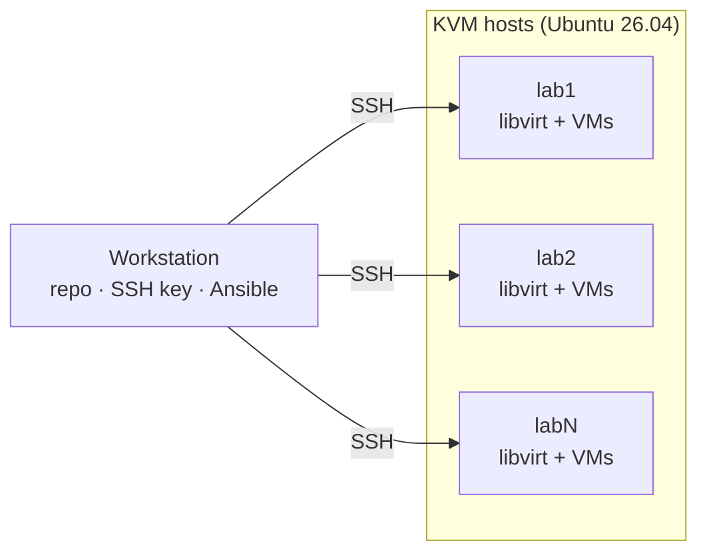

# Ephemeral Labs
Ephemeral Labs with KVM and Terraform/OpenTofu



## Setup

Run everything from your workstation; the targets are Ubuntu 26.04 hosts.

### 1. Prepare each target

* Turn on virtualization (VT-x/AMD-V) in BIOS/UEFI
* Install openssh-server
```bash
sudo apt update && sudo apt install -y openssh-server
```

### 2. Get the repo (workstation)

```bash
git clone https://github.com/turnes/ephemeral-labs.git
cd ephemeral-labs
```

### 3. SSH access

```bash
cp bootstrap/ssh-hosts.example bootstrap/ssh-hosts   # edit: name address user [port]
./bootstrap/setup-ssh.sh
```

This creates `~/.ssh/ephemeral-labs/id_ed25519`, writes one `~/.ssh/ephemeral-labs/<name>.conf` per host, adds `Include ~/.ssh/ephemeral-labs/*.conf` to `~/.ssh/config` and copies the key to each host. Re-run it after editing `ssh-hosts`.

### 4. Install KVM

Pick one option.

**Ansible** (list the host names from `ssh-hosts` under `[kvm_hosts]` in `ansible/inventory.ini`):

```bash
sudo apt update && sudo apt install -y ansible-core
cd ansible
ansible-playbook -i inventory.ini install-kvm.yml -K   # add -e kvm_with_gui=true for virt-manager
```

**Bootstrap script** (one host at a time):

```bash
scp bootstrap/install-kvm-ubuntu.sh lab1:
ssh -t lab1 sudo ./install-kvm-ubuntu.sh            # add --with-gui for virt-manager
```

### 5. Verify

```bash
ssh lab1 kvm-ok
ssh lab1 virsh -c qemu:///system list --all
```

## Roadmap: `elab` CLI

A single entry point (`bin/elab`, bash) that wraps the scripts above:

```
elab check                  # hardware preflight
elab install [--ansible]    # install KVM on lab hosts
elab hosts add|rm|ls        # manage lab hosts
elab ssh setup | <name>     # set up keys / connect
elab up|down|status <lab>   # terraform in modules/
```

Hosts live in one file under `~/.config/ephemeral-labs/`, and `elab` generates both the SSH configs and the Ansible inventory from it.
