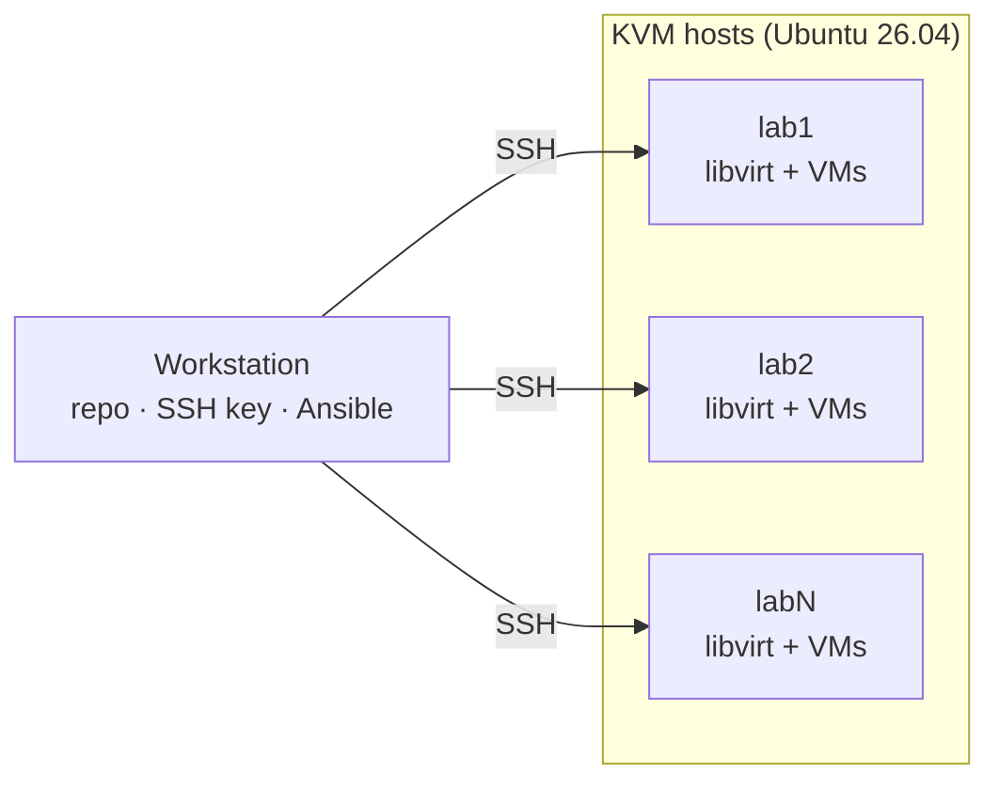

# Ephemeral Labs
Ephemeral Labs with KVM and Terraform/OpenTofu



## Setup

Run everything from your workstation; the targets are Ubuntu 26.04 hosts.

### 1. Prepare each target

* Turn on virtualization (VT-x/AMD-V) in BIOS/UEFI
* Install openssh-server
```bash
sudo apt update && sudo apt install -y openssh-server
```

### 2. Get the repo (workstation)

```bash
git clone https://github.com/turnes/ephemeral-labs.git
cd ephemeral-labs
```

### 3. Inventory

```bash
cp inventory.example.yml inventory.yml   # edit hosts
```

`inventory.yml` is an Ansible inventory; the SSH script reads it too.

### 4. SSH access

```bash
./bootstrap/setup-ssh.sh
```

This creates `~/.ssh/ephemeral-labs/id_ed25519`, writes one `~/.ssh/ephemeral-labs/<name>.conf` per host, adds `Include ~/.ssh/ephemeral-labs/*.conf` to `~/.ssh/config` and copies the key to each host. Re-run it after editing `inventory.yml`.

### 5. Install KVM

```bash
sudo apt update && sudo apt install -y ansible-core
ansible-playbook ansible/install-kvm.yml -K --tags hwcheck   # hardware check only
ansible-playbook ansible/install-kvm.yml -K                  # add -e kvm_with_gui=true for virt-manager
```

### 6. Storage pools

```bash
ansible-playbook ansible/storage-pool.yml -K
```

| Pool | Path | Used by |
|------|------|---------|
| `elab-images` | `/var/lib/libvirt/elab/images` | Packer uploads base/golden images; Terraform clones from them |
| one per lab | `/var/lib/libvirt/elab/labs/<lab>` | Created and destroyed by Terraform with the lab |

### 7. Network bridge

```bash
ansible-playbook ansible/network-bridge.yml -K   # -e elab_bridge_interface=<nic> to pick a NIC
```

Moves the host's wired NIC (default-route interface) into `br0`, keeping its IP, and defines the libvirt network `elab-bridge` so lab VMs get addresses on the LAN. If Ansible can't reconnect after the switch, the host restores its original netplan config within 3 minutes. Originals are kept in `/etc/netplan/elab-backup/`.

### 8. Lab tools

```bash
ansible-playbook ansible/install-tools.yml -K
```

Installs `terraform` and `packer` (HashiCorp apt repo), `cloud-image-utils` (`cloud-localds`) and `virtinst` (`virt-install`) on the KVM hosts.

### 9. Cloud images

```bash
ansible-playbook ansible/cloud-images.yml -K
```

Downloads the latest Ubuntu 26.04 build from [resolute/current](https://cloud-images.ubuntu.com/resolute/current/) into the `elab-images` pool as a versioned, checksum-verified volume, e.g. `ubuntu-26.04-20260927.qcow2`. Terraform should reference that exact name. Re-running after a new build adds a new volume; existing ones are never replaced.

### 10. Verify

```bash
ssh lab1 kvm-ok
ssh lab1 virsh -c qemu:///system list --all
ssh lab1 virsh -c qemu:///system pool-list --all
ssh lab1 virsh -c qemu:///system vol-list --pool elab-images
ssh lab1 virsh -c qemu:///system net-list --all
ssh lab1 ip -br addr show br0
```

## Roadmap: `elab` CLI

A single entry point (`bin/elab`, bash) that wraps the scripts above:

```
elab check                  # hardware preflight
elab install                # install KVM on lab hosts (Ansible)
elab pool                   # create storage pools (Ansible)
elab bridge                 # create LAN bridge br0 (Ansible)
elab tools                  # install terraform, packer, cloud-image-utils (Ansible)
elab images                 # download cloud images into elab-images (Ansible)
elab hosts add|rm|ls        # manage lab hosts
elab ssh setup | <name>     # set up keys / connect
elab up|down|status <lab>   # terraform in modules/
```

`elab hosts` edits `inventory.yml`, the single source for SSH and Ansible.
